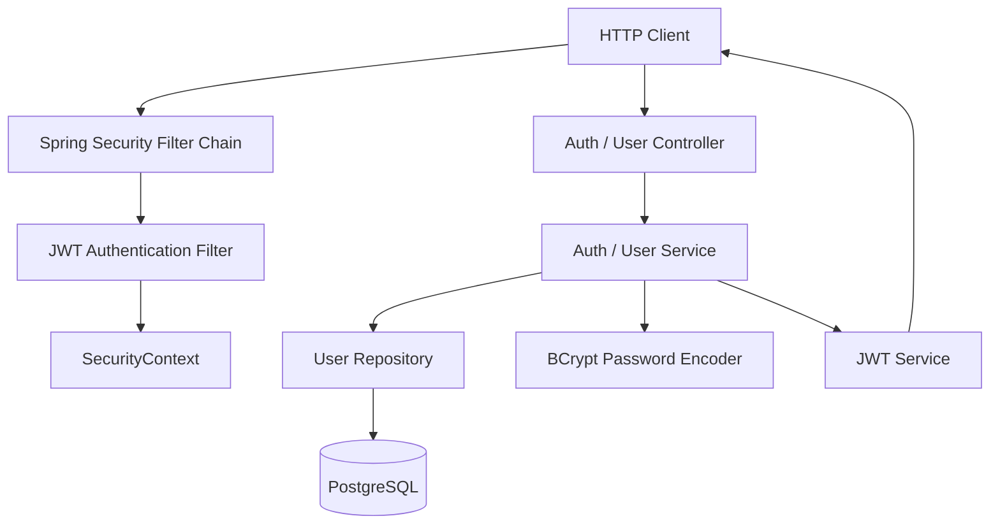
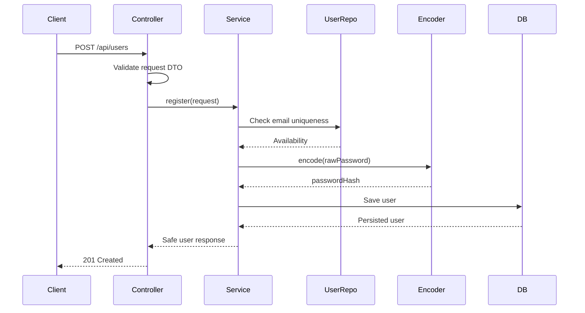
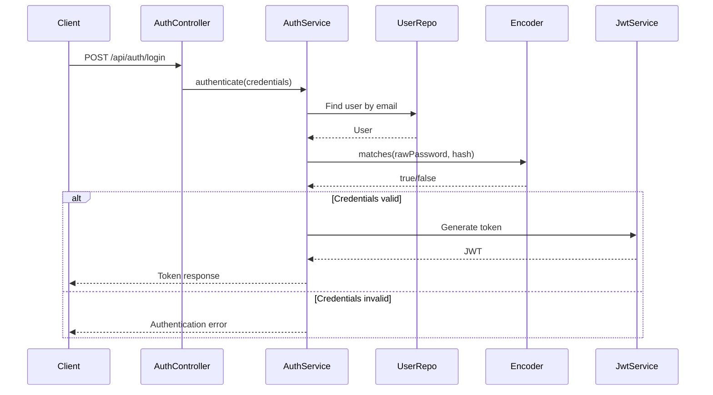
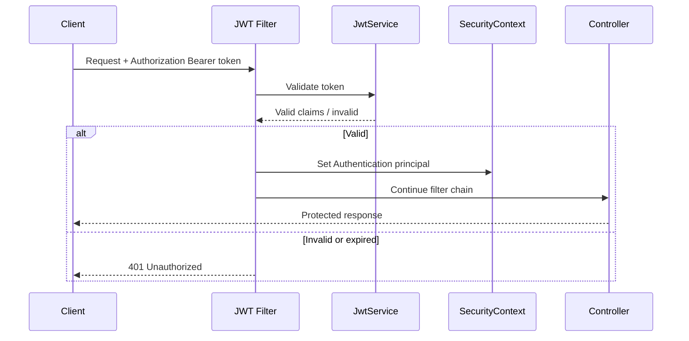

# Architecture — Authentication & Authorization

## 1. Architectural overview

Modul autentikasi mengikuti layered architecture yang telah digunakan backend NexScale.



Alur request privat melewati Spring Security Filter Chain terlebih dahulu. Jika token valid, identitas pengguna dimasukkan ke `SecurityContext`, lalu controller dan service dapat menggunakan principal tersebut.

## 2. Layer responsibilities

| Layer | Tanggung jawab | Tidak boleh |
|---|---|---|
| Controller | HTTP mapping, menerima DTO, mengembalikan response | Menulis query database atau aturan bisnis kompleks |
| DTO | Kontrak request/response dan validasi input | Menjadi Entity JPA |
| Service | Aturan bisnis, transaksi, orkestrasi autentikasi | Mengurus detail HTTP |
| Repository | Akses data melalui Spring Data JPA | Menentukan hak akses dari request mentah |
| Entity | Representasi data persisten dan relasi | Diekspos langsung sebagai response API |
| Security filter | Membaca token dan membangun Authentication | Mengimplementasikan seluruh business flow |
| JWT service | Membuat dan memvalidasi JWT | Menyimpan secret di source code |
| Password encoder | Hash dan verifikasi password | Mengembalikan password asli |

## 3. Registration flow



Jika registrasi juga membuat ClientProfile atau ProviderProfile, seluruh operasi harus berada dalam satu transaksi. Pastikan role dan relasi profil sesuai desain database aktual.

## 4. Login flow



## 5. Authenticated request flow



## 6. Security configuration principles

- Public endpoints harus didefinisikan secara eksplisit, misalnya login, registrasi, dan health check.
- Endpoint lain default-nya authenticated kecuali ada alasan yang terdokumentasi.
- Gunakan authorities/roles sesuai format yang konsisten dengan konfigurasi Spring Security.
- Jangan mengandalkan frontend untuk menyembunyikan tombol atau halaman sebagai kontrol keamanan.
- `401 Unauthorized`: identitas tidak ada atau token tidak valid.
- `403 Forbidden`: identitas valid tetapi tidak memiliki izin.
- Hindari mengirim stack trace atau detail internal ke client.

## 7. Identity and ownership

Untuk endpoint `/api/users/me`, ambil identitas dari principal/SecurityContext.

Pola yang harus dihindari:
```java
// Jangan menentukan identitas pengguna dari ID bebas yang dikirim client.
@GetMapping("/me")
public Object me(@RequestParam Long userId) {
    // ...
}
```

Pola yang diharapkan secara konseptual:
```java
// Identitas diambil dari principal yang telah diautentikasi.
@GetMapping("/me")
public UserResponse me(Authentication authentication) {
    // Delegasikan ke service menggunakan identitas principal.
}
```

Sesuaikan tipe principal, nama claim, dan implementasi dengan kode aktual.

## 8. Transaction boundaries

Registrasi adalah kandidat transaksi karena dapat membuat User dan profil terkait. Letakkan batas transaksi di service, bukan controller.

- Validasi input sebelum persistensi.
- Cek keunikan untuk pesan error yang baik.
- Tetap gunakan unique constraint di database untuk mengatasi race condition.
- Jika salah satu penyimpanan gagal, rollback seluruh operasi.

## 9. Configuration and secrets

Gunakan environment variables atau secret manager untuk:
- JWT signing secret/private key.
- JWT expiration.
- Database credentials.
- Environment-specific settings.

Jangan commit `.env` yang berisi secret. Sediakan `.env.example` hanya dengan placeholder. Jangan menurunkan panjang atau kekuatan secret demi mengatasi error konfigurasi.

## 10. Package structure — target konseptual

Jangan membuat package baru sebelum memeriksa struktur aktual. Bentuk konseptual:

```text
com.nexscale.api
├── auth
│   ├── controller
│   ├── service
│   └── dto
├── user
│   ├── controller
│   ├── service
│   ├── repository
│   ├── entity
│   └── dto
├── security
│   ├── config
│   ├── filter
│   └── service
└── common
    ├── exception
    └── response
```

Jika project menggunakan struktur package berbeda, ikuti struktur yang sudah ada. Hindari refactor besar hanya untuk mencocokkan diagram ini.

## 11. Design decisions to verify

Sebelum implementasi lanjutan, verifikasi:
1. Nama dan tipe primary key User.
2. Nama field email/password/role pada entity.
3. Bentuk enum role dan mapping authority.
4. Algoritma, claim, issuer, subject, dan expiry JWT.
5. Apakah refresh token tersedia.
6. Filter JWT dan urutan filter Spring Security.
7. Format error global.
8. Relasi User dengan ClientProfile dan ProviderProfile pada migration.
