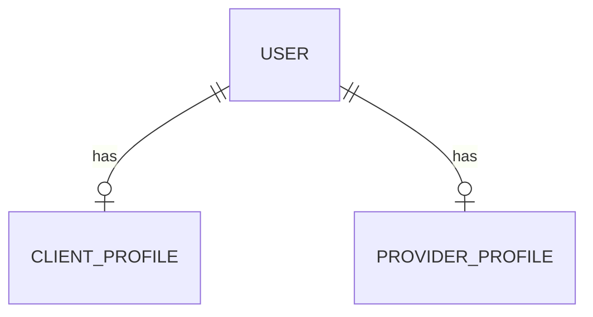

# Data Model — Identity & Authentication

## 1. Tujuan

Dokumen ini menjelaskan data identity yang diperlukan untuk autentikasi. Skema final harus mengikuti Entity dan Flyway migration aktual.

## 2. Konsep entitas

### User

Mewakili akun yang dapat masuk ke sistem.

Field konseptual:
| Field | Tujuan | Catatan |
|---|---|---|
| `id` | Identitas unik | Tipe mengikuti schema aktual |
| `name` | Nama tampilan | Validasi panjang dan karakter |
| `email` | Identitas login | Harus unik dan dinormalisasi |
| `password_hash` | Hash password | BCrypt; tidak pernah plaintext |
| `role` | Hak akses dasar | BUYER, SELLER, ADMIN |
| timestamps | Audit waktu | Ikuti pola entity/migration |

Nama field di atas bersifat konseptual. Jangan mengubah nama kolom yang sudah ada tanpa migration dan rencana kompatibilitas.

### Role

Tiga role produk yang diketahui:
- `BUYER`
- `SELLER`
- `ADMIN`

Registrasi publik hanya boleh membuat role yang memang diizinkan. Admin harus dibuat melalui proses administratif yang aman.

### Role-specific profile

Profil domain dapat dipisahkan dari akun utama:
- `ClientProfile` untuk Buyer.
- `ProviderProfile` untuk Seller.

Sebelum mengimplementasikan pembuatan profil otomatis, verifikasi apakah kedua entity, repository, tabel, foreign key, dan constraint benar-benar tersedia. Audit sebelumnya memberikan informasi yang tidak konsisten mengenai ProviderProfile.

## 3. Relationship concept

Diagram ini adalah target konseptual, bukan pernyataan bahwa relasi tersebut sudah terimplementasi. Kardinalitas dan nama foreign key wajib dicocokkan dengan migration.

## 4. Password lifecycle

1. Client mengirim password melalui HTTPS.
2. Server memvalidasi request.
3. Server meng-hash password dengan BCrypt.
4. Server menyimpan hash, bukan password asli.
5. Saat login, server memanggil `matches(rawPassword, storedHash)`.
6. Password asli tidak dicatat ke log, response, atau database.

Jangan meng-hash password dua kali secara manual jika PasswordEncoder sudah melakukan hashing.

## 5. JWT conceptual claims

Claim yang mungkin diperlukan:
- `sub`: identifier pengguna atau subject stabil.
- `iat`: waktu token diterbitkan.
- `exp`: waktu kedaluwarsa.
- `iss`: issuer, jika digunakan.
- role/authority: hanya jika desain token saat ini menggunakannya.

Jangan menambah claim baru tanpa mengevaluasi kompatibilitas filter, service, dan test yang sudah ada. Jangan menyimpan password, password hash, atau data pribadi berlebihan di JWT.

## 6. Database integrity

- Unique constraint pada email.
- Foreign key untuk relasi profil.
- Not-null constraint pada field wajib.
- Index pada field yang sering dipakai untuk lookup.
- Semua perubahan schema melalui Flyway.

## 7. Migration policy

Sebelum menambah migration:
1. Baca seluruh migration relevan.
2. Periksa schema yang sudah terbentuk.
3. Pastikan perubahan belum ada.
4. Buat migration baru dengan nomor berikutnya yang valid.
5. Jangan mengedit migration yang sudah pernah diterapkan di environment bersama.
6. Uji migration pada database development/test.
